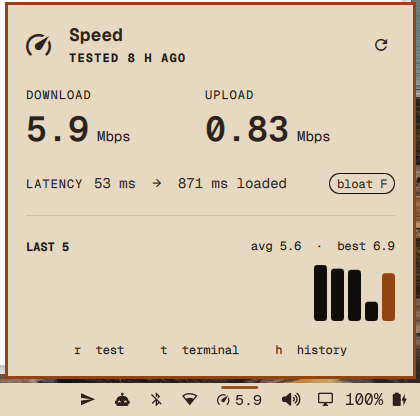

# Speed

An Omarchy bar widget that runs fast.com speed tests. The bar shows your last download speed. Click it to see download, upload, idle and loaded latency, a bufferbloat grade, and a chart of your recent tests.



## Install

```sh
omarchy pkg add bun
omarchy plugin add https://github.com/dumbld0re/omarchy-speed.git --enable
```

Or open **Settings → Plugins**, enable **Speed**, and place it in a bar section.

Optional: compile the CLI into one binary so it starts faster and can be used in a terminal:

```sh
cd ~/.config/omarchy/plugins/danny-miguel.speed/cli
bun run install-bin   # installs ~/.local/bin/speed
```

The widget uses `~/.local/bin/speed` when it exists. Otherwise it runs the bundled source in `cli/` with Bun.

## Use

- **Click**: open the panel. **Right-click**: run a test. **Middle-click**: run the live test in a terminal.
- In the panel: `r` runs a test, `t` opens the terminal view, `h` shows history.
- From scripts: `omarchy-shell danny-miguel.speed run`.

Settings: **Test automatically every N minutes** (0 = off) and **Show upload in the bar**.

## How it measures

The bundled `speed` CLI (`cli/`) connects directly to the Netflix servers that fast.com uses. Download runs 8 parallel range requests and stops once the rate holds steady. Upload counts bytes only after the server acknowledges them. Latency is the median of 10 small requests, measured idle and again under load; the gap between the two sets the bufferbloat grade. See [`cli/README.md`](cli/README.md) for details.

## Data

- History: `~/.local/share/fast-cli/history.db` (SQLite)
- Cached fast.com token: `~/.cache/fast-cli/`

## Dependencies

- [Bun](https://bun.sh) (`omarchy pkg add bun`)
- Network access to fast.com and its Netflix test servers. Each test uses tens of megabytes, more on fast connections.

## Remove

```sh
omarchy plugin remove danny-miguel.speed
rm -rf ~/.local/share/fast-cli ~/.cache/fast-cli ~/.local/bin/speed
```

## License

MIT © Danny-Miguel
